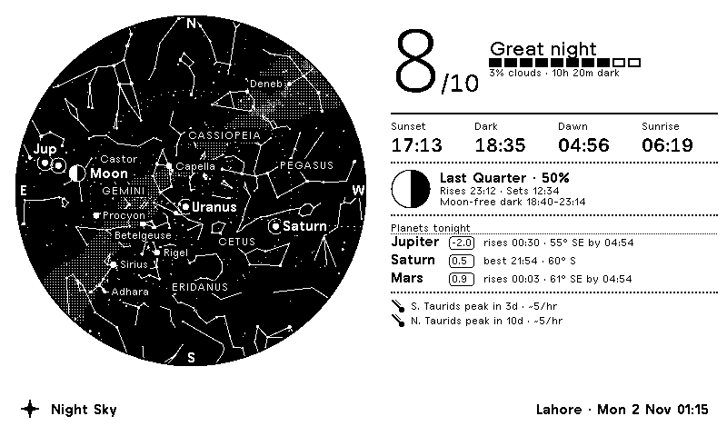
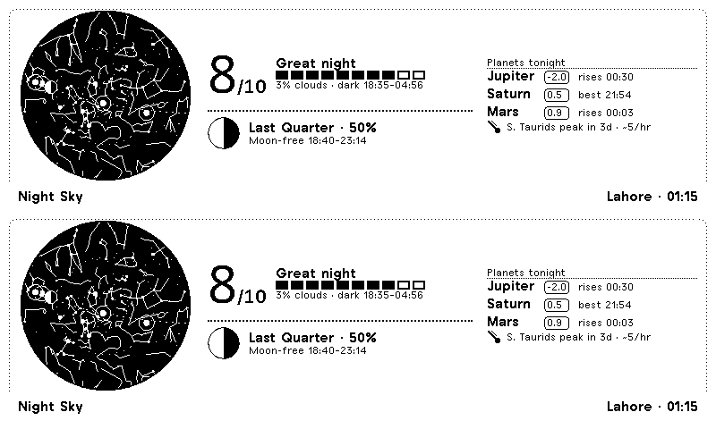
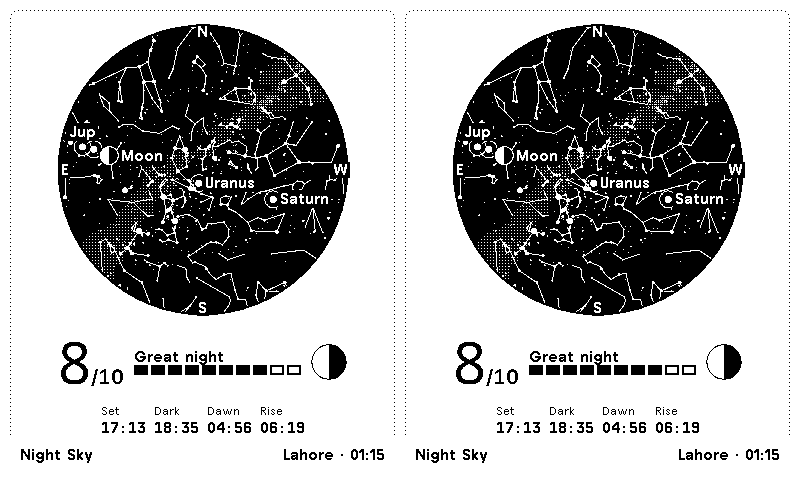
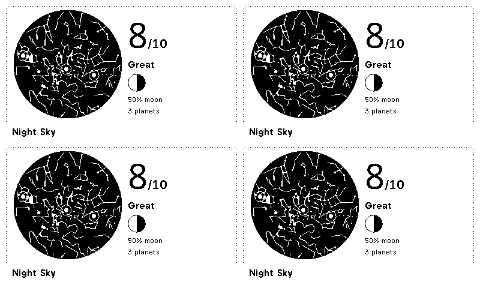

# Night Sky ✦ for TRMNL

**A live star chart of the sky above you, drawn for e-ink, plus a forecast that answers one question: *is tonight worth going outside?***



Every refresh, the backend works out exactly where ~2,300 stars, 89 constellation figures, the
Milky Way, all seven planets and the Moon are above **your** location right now. It projects them
onto a dome chart and sends them to your TRMNL as compact vector paths. The panel beside the
chart scores the night from 0 to 10 using real darkness hours, moonlight and the cloud forecast,
then tells you when it gets dark, what the Moon is doing, which planets to look for and when,
and whether a meteor shower or close conjunction is on.

No API keys. No paid services. The astronomy engine is written from scratch in pure
Python and checked against PyEphem to within 0.1°.

| half_horizontal | half_vertical | quadrant |
|---|---|---|
|  |  |  |

*(All previews are the actual 1-bit output, so this is exactly what the e-ink panel shows.)*

---

## Features

- **Real sky chart.** A stereographic all-sky projection with the zenith in the centre and north
  up. East is on the left, the way the sky looks when you lie on your back. It shows stars down to
  magnitude 5 in six sizes, constellation stick figures, a dotted ecliptic, and altitude rings at
  30° and 60°.
- **Dithered Milky Way.** Two brightness levels drawn with hand-built 1-bit dot patterns, so they
  look like a glow on e-ink instead of a gray smudge.
- **Planets and Moon.** Each sits at its true position. The Moon is drawn at its *actual phase*
  and flipped for the southern hemisphere.
- **Smart labels.** Labels are placed greedily (Moon, then planets, then bright stars, then
  constellations), never overlap and never spill past the horizon. Each one can sit right, left,
  above or below its object.
- **Stargazing score, 0–10.** Weighs astronomical darkness hours, Moon altitude × illumination
  through the night, and Open-Meteo cloud cover for the dark window.
- **Tonight's timeline.** Sunset, astronomical dusk and dawn, sunrise, moonrise and moonset, and
  the longest *Moon-free dark window*.
- **Planet planner.** For each planet: magnitude, rise time, and the best time and direction to
  look.
- **Highlights.** Moon–planet and planet–planet conjunctions (only when you can actually see
  them), active meteor showers with peak countdowns, and upcoming full and new moons.
- **Daytime-aware.** During daylight, the chart shows *tonight's* sky, an hour after civil dusk,
  so the screen is always useful.
- **Works anywhere on Earth.** Southern hemisphere, polar night and midnight sun (the score drops
  to 0 and darkness falls back to −12° when the sky never gets fully dark) are all handled and
  tested.
- **All 4 TRMNL layouts:** full, half horizontal, half vertical and quadrant. They share one
  `` chart partial.
- **Pixel-perfect on e-ink.** The chart uses `crispEdges`, `non-scaling-stroke` star dots and the
  framework's own TRMNL pixel fonts. Nothing relies on gray anti-aliasing.

## How it works

```
 TRMNL cloud  ── polls every 30 min ──▶  Night Sky backend  (/sky?loc=lat,lon)
      │                                     │  astro.py   sun, moon, planets, precession, rise/set
      │                                     │  sky.py     projection, score, labels, highlights
      │                                     │  catalog    2,309 stars, 89 constellations, Milky Way
      │                                     └─ Open-Meteo cloud cover + timezone (optional, cached)
      ▼
 Liquid templates (plugin/src) turn ~20 KB of JSON into SVG + framework HTML ──▶ e-ink
```

The backend does the heavy lifting: about 2,300 coordinate transforms per request in roughly
20 ms. It returns geometry as compact SVG path strings (`M412 133h0M…` for star dots,
`M…L…` for figures), so the Liquid stays simple and the payload stays around 20–25 KB.

```
backend/
  server.py      stdlib HTTP server  (GET /sky, /healthz)
  sky.py         builds the payload
  astro.py       dependency-free ephemeris
  data/catalog.json
plugin/          a trmnlp project: push it straight to TRMNL
  src/{full,half_horizontal,half_vertical,quadrant,shared}.liquid
  src/settings.yml
tools/
  preview.py     local renderer: Liquid -> Chromium screenshot -> 1-bit PNG
  build_catalog.py
tests/test_sky.py
```

## Accuracy

`astro.py` implements:
- Sun: Astronomical Almanac low-precision formulae
- Moon: Schlyter's method with 12 longitude and 5 latitude perturbation terms, plus topocentric parallax
- Planets: JPL Keplerian elements (Standish) with IAU 1976 precession to the date
- Magnitudes: Explanatory Supplement formulae, including Saturn's ring tilt

Checked against PyEphem over several dates and both hemispheres:

| body | worst error |
|---|---|
| Sun | 0.006° |
| Moon | 0.024° |
| Planets | ≤ 0.08° |
| Moon illumination | 0.2 % |

One pixel on the full-layout chart is about 0.3° of sky, so the errors are below what the screen
can show.

## Run it

**Backend.** Needs Python 3.9+ and nothing else:

```sh
python3 backend/server.py                      # http://localhost:8080
curl "localhost:8080/sky?loc=51.48,0&label=Greenwich"
```

Or with Docker:

```sh
docker build -t night-sky . && docker run -p 8080:8080 night-sky
```

Deploy it anywhere that serves HTTPS: Render, Fly.io, Railway, a VPS or a Raspberry Pi behind
Cloudflare Tunnel.

| query param | meaning |
|---|---|
| `loc` | `lat,lon` (required). The TRMNL `lat_lon` field passes this directly |
| `label` | place name for the title bar |
| `tz` | IANA zone. Auto-detected from coordinates via Open-Meteo if omitted |
| `mode` | `auto` (default; show tonight's sky in daytime) or `now` |
| `clock` | `24` or `12` |
| `clouds` | `yes` or `no`. Include the cloud forecast in the score |
| `t` | ISO instant to render, e.g. `2026-12-14T22:00:00Z`. Handy for the Geminids |

**Plugin.**
1. Set `polling_url` in `plugin/src/settings.yml` to your backend host.
2. Run `cd plugin && trmnlp login && trmnlp push`, or paste each `.liquid` file into a Private
   Plugin's markup editor (Shared, Full, Half Horizontal, Half Vertical, Quadrant tabs) and copy the
   polling URL and form fields across.
3. Pick your location in the plugin settings.

**Preview locally without a device:**

```sh
pip install python-liquid playwright pillow && playwright install chromium
python3 tools/preview.py --loc 31.52,74.36 --label Lahore
open preview/index.html            # grayscale + 1-bit renders of all four layouts
```

**Tests:** `python3 -m unittest discover tests`. Install `ephem` as well to run the PyEphem
cross-check.

## Credits

- Star, constellation and Milky Way data: [d3-celestial](https://github.com/ofrohn/d3-celestial) © Olaf Frohn, BSD-3-Clause
- Cloud forecast and timezone lookup: [Open-Meteo](https://open-meteo.com) (free, no key)
- Meteor shower calendar: International Meteor Organization
- Planet elements: E. M. Standish, JPL Solar System Dynamics

---

<p align="center"><sub><i>Disclaimer: this README was generated by AI. I'm honestly terrible at describing my own projects (my first draft is usually just "it does the thing, trust me"), so I let a robot do the explaining.</i></sub></p>
